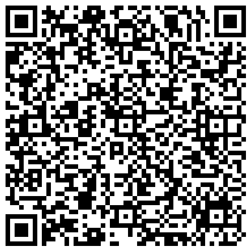

<p align="center">
  
</p>

# Galaxy S23 Ultra Firehose Loader (SM-S918B)

Latest Firehose loader for the Samsung Galaxy S23 Ultra (SM-S918B), BIT A / U10, One UI 9.

## Install on Arch Linux

Run these commands from the project folder. The first installs the dependencies. The second builds QDL 2.9.1 and installs its USB access rule.

```sh
sudo pacman -S --needed gcc pkgconf git meson ninja libusb libxml2 usbutils
./setup.sh
```

## How to use

Connect one SM-S918B in EDL mode over USB and check the connection.

```sh
./firehose.sh check
```

### Read `init_boot`

Save a verified copy. The command prints the backup path.

```sh
./firehose.sh backup-init-boot
```

### Write `init_boot`

To restore `init_boot`, replace `YOUR-BACKUP` with the backup folder from this phone and firmware.

```sh
.tools/qdl --backend=usb --storage=ufs --skip-reset \
  loader/sm-s918b-bit-a-firehose.elf \
  write 0/init_boot "backups/YOUR-BACKUP/init_boot.img"
```

## 🇧🇷 É Brazuca também?

Deixe um apoio usando Pix.

Sua ajuda motiva expandir esse trabalho pra novos devices e é um jeito de
agradecer pelas noites sem dormir por trás desse port.

**Chave Pix:** `de68ce24-a653-4094-9f5c-1504917d14ea`

<p align="center">
  
</p>

## License

The scripts and this README use the [MIT License](LICENSE). The bundled Firehose loader is third-party firmware.
